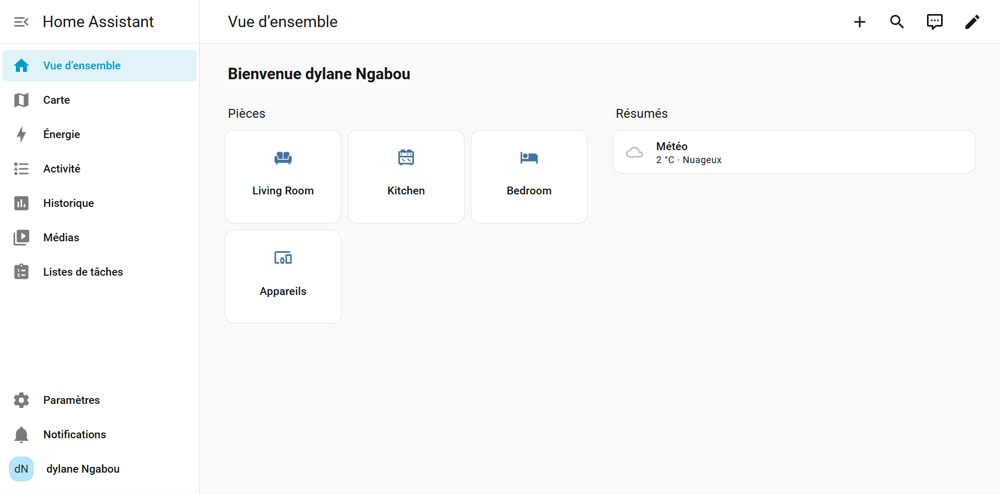

# 🏠🤖 Une IA pour ma chambre

Projet personnel : une **IA avec qui je peux parler**, qui **contrôle ma chambre** (lumières, prises) et qui servira de **système de sécurité** (caméra, capteurs, alertes sur mon téléphone).

Le « cerveau » est **Home Assistant**, une plateforme open source de maison intelligente. Pour apprendre avant d'acheter du matériel, je l'ai d'abord installé gratuitement dans une **machine virtuelle VirtualBox** sur mon PC portable.



## Comment ça marche

```
🎙️ Ma voix
   │
   ▼
👂 Whisper (reconnaissance vocale, en local)   → transforme ma voix en texte
   │
   ▼
🧠 Claude (Anthropic)                          → comprend et exécute l'action dans Home Assistant
   │
   ▼
🗣️ Piper (synthèse vocale, en local)           → me répond à voix haute en français
```

## Technologies

| Outil | Rôle |
|---|---|
| **Home Assistant OS 18.4** | Plateforme de maison intelligente (le cerveau) |
| **Oracle VirtualBox 7.2** | Machine virtuelle sur Windows 11 |
| **Claude (Anthropic)** | Agent de conversation (IA) |
| **Whisper** (faster-whisper) | Reconnaissance vocale, en local |
| **Piper** | Synthèse vocale française, en local |

## Documentation

1. [Installation de Home Assistant dans VirtualBox](docs/01-installation-vm.md)
2. [Brancher l'IA Claude](docs/02-integration-claude.md)
3. [Assistant vocal : Whisper + Piper](docs/03-assistant-vocal.md)

Chaque partie contient les étapes, les captures d'écran, et surtout **les problèmes rencontrés avec leur solution**.

Script pour recréer la VM : [`scripts/creer-vm-homeassistant.ps1`](scripts/creer-vm-homeassistant.ps1)

## État du projet

- [x] Home Assistant installé dans une VM
- [x] IA Claude branchée et en français
- [x] Je parle à l'IA et elle me répond à voix haute
- [ ] Ampoules et prises connectées (TP-Link Tapo)
- [ ] Boîtier dédié Home Assistant Green (24 h/24)
- [ ] Micro Home Assistant Voice
- [ ] Sécurité : caméra, capteurs de porte, alertes

## Auteur

Joris Dylane Touossock Ngabou, étudiant au Collège Boréal.
