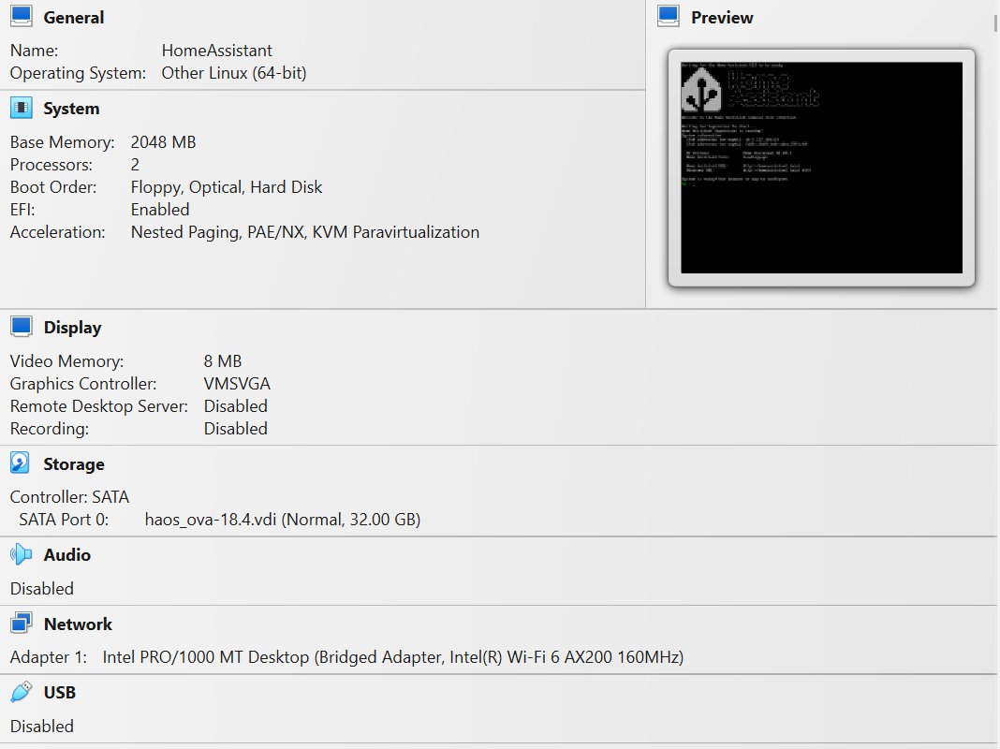
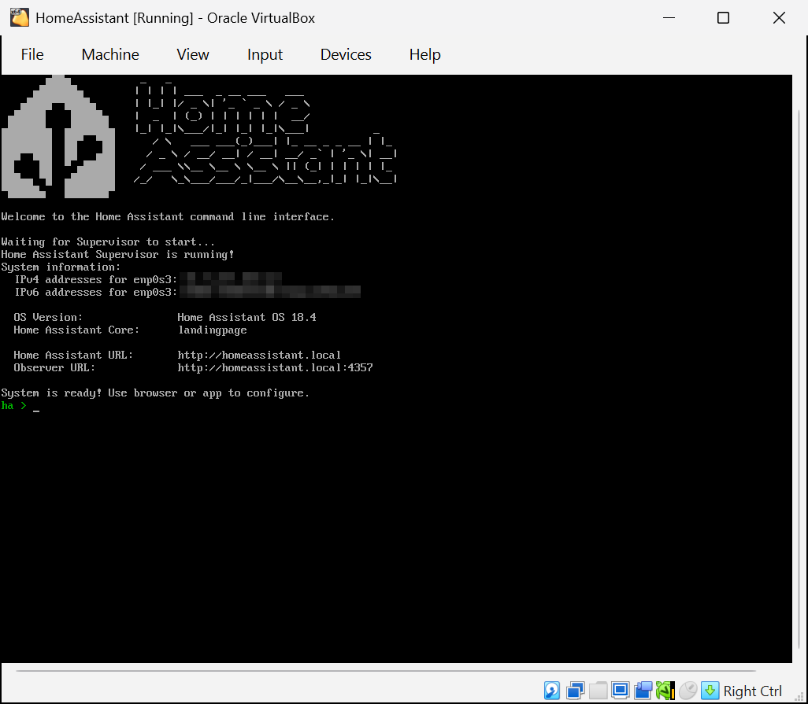
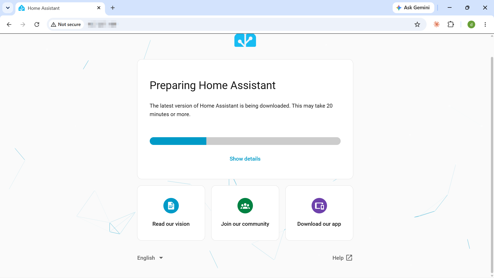
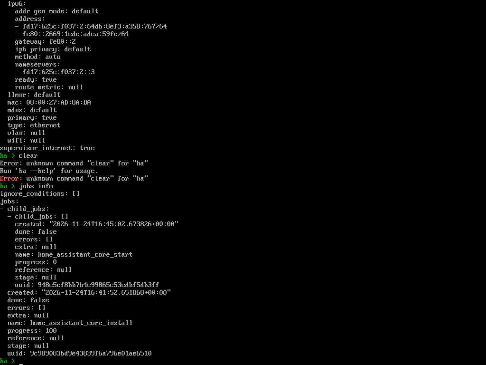
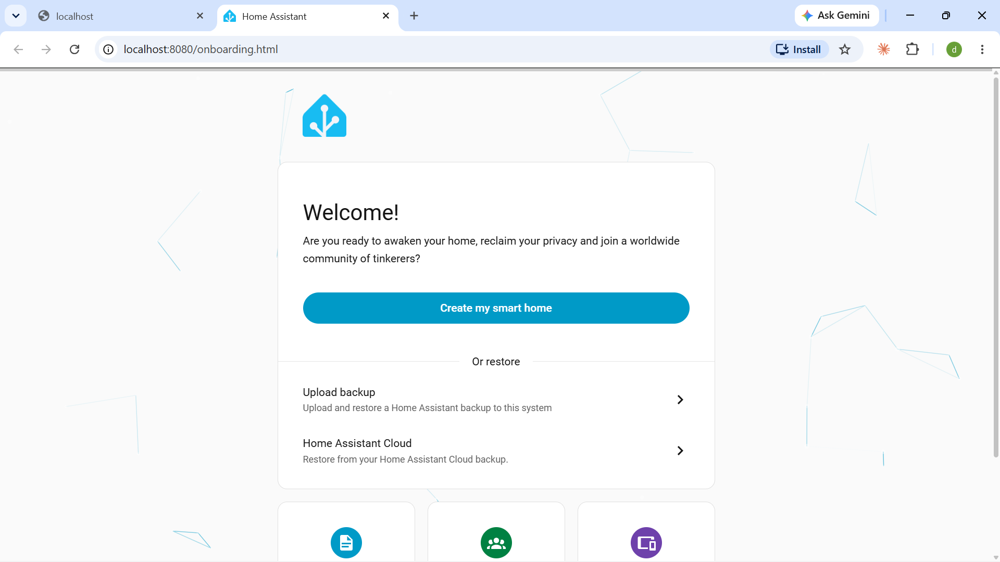
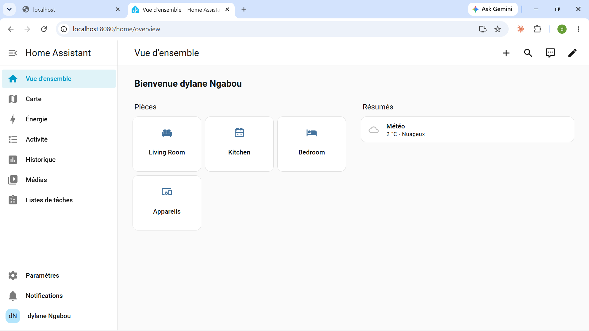
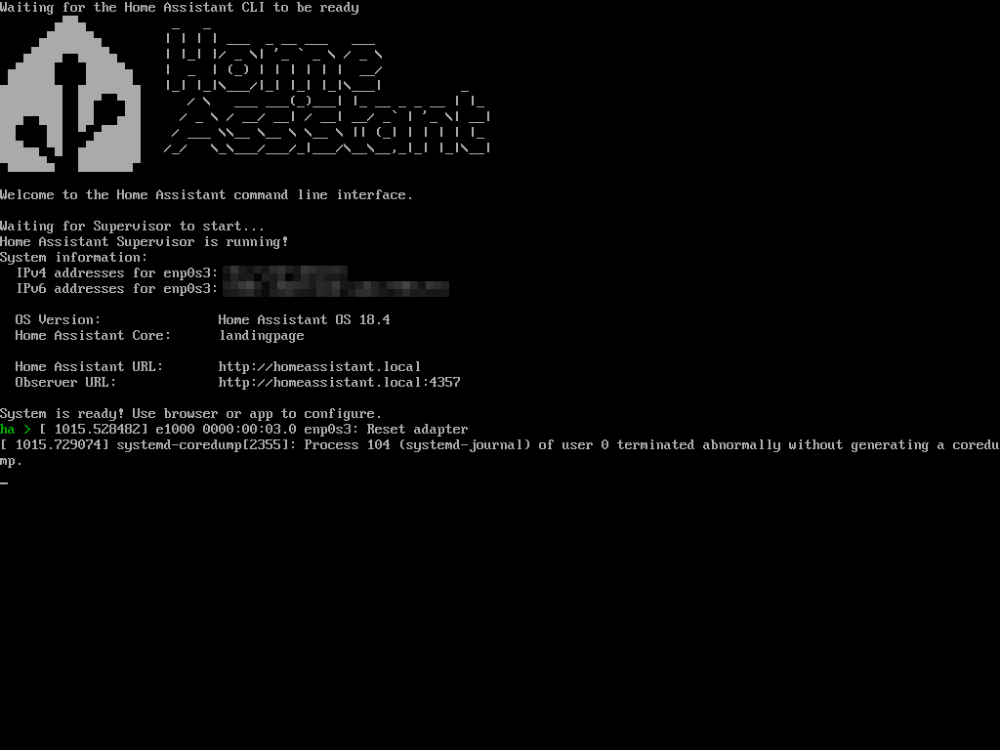
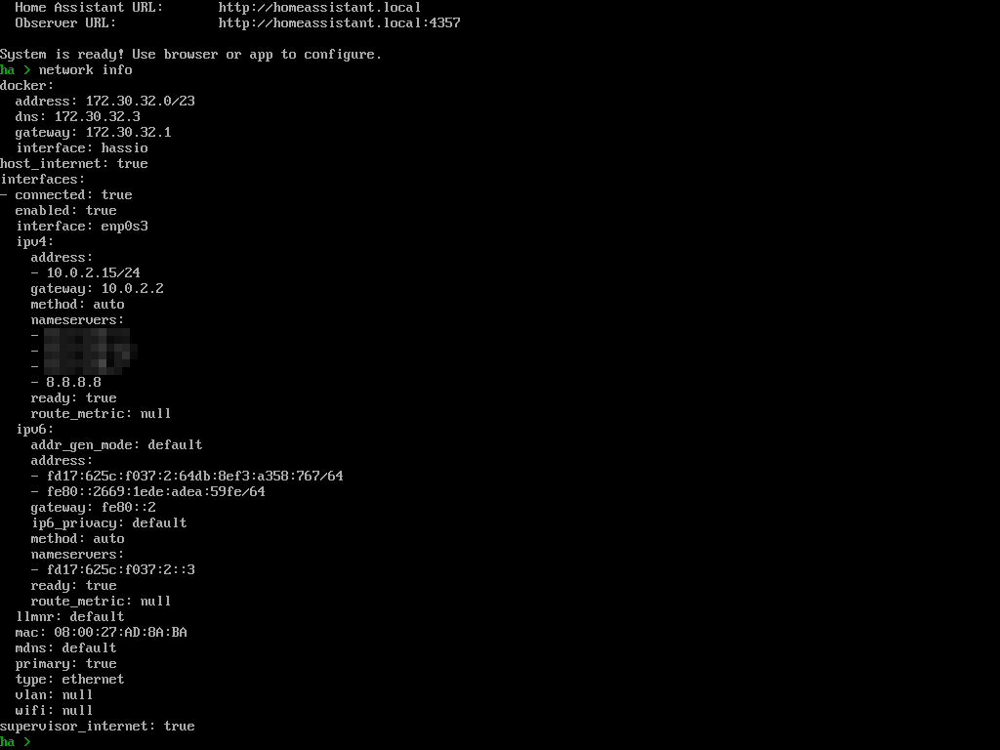
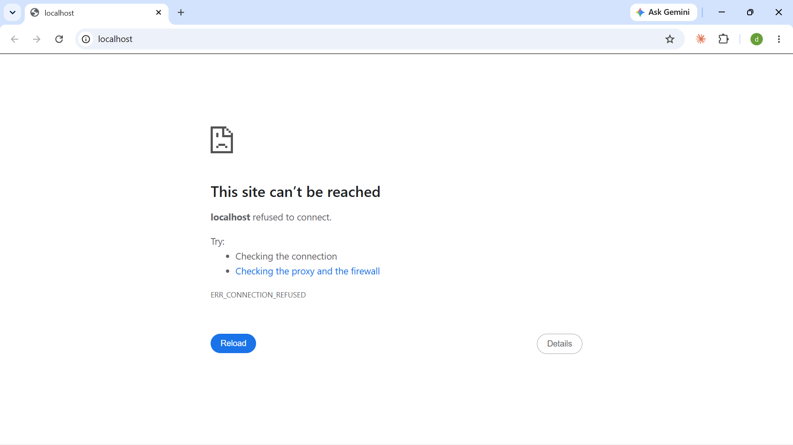

# Partie 1 — Installer Home Assistant dans VirtualBox

**Objectif :** installer gratuitement le « cerveau » du système, **Home Assistant OS**, dans une machine virtuelle, pour apprendre avant d'acheter le matériel.

[← Retour au README](../README.md) · [Partie 2 →](02-integration-claude.md)

---

## Étapes

### 1. Télécharger Home Assistant OS
Image officielle pour VirtualBox (`haos_ova-18.4.vdi`), sur le [GitHub de Home Assistant](https://github.com/home-assistant/operating-system/releases).

### 2. Créer la machine virtuelle
Tout est automatisé dans [`scripts/creer-vm-homeassistant.ps1`](../scripts/creer-vm-homeassistant.ps1).

| Paramètre | Valeur | Pourquoi |
|---|---|---|
| Mémoire | 2 Go au départ → **4 Go** | 2 Go suffisent pour Home Assistant, pas pour la reconnaissance vocale ([partie 3](03-assistant-vocal.md)) |
| Processeurs | 2 au départ → **4** | Idem |
| Démarrage | **EFI activé** | Obligatoire : Home Assistant OS ne démarre pas sans EFI |
| Disque | 32 Go | Taille recommandée |
| Réseau | NAT + redirection de ports | Voir problème n° 1 |

### 3. Premier démarrage
La console affiche « System is ready! » : le système de base fonctionne.

### 4. Téléchargement de Home Assistant
Au premier démarrage, Home Assistant télécharge sa dernière version (environ 20 minutes).

La commande `jobs info` dans la console confirme que l'installation est à 100 % :

### 5. Écran de bienvenue

### 6. Compte créé et tableau de bord
Compte, localisation, fuseau horaire et unités configurés.

---

## Problèmes rencontrés et solutions

### Problème 1 — « Cannot get network information » sur le Wi-Fi du collège

- **Symptôme :** la page de préparation affichait « Cannot get network information », et la console montrait des erreurs réseau (`Reset adapter`).
- **Cause :** la VM était en **mode pont** (bridged) : elle se connectait directement au Wi-Fi du collège comme un appareil séparé. Les réseaux Wi-Fi d'école ou d'entreprise acceptent mal qu'un deuxième appareil passe par la même carte Wi-Fi.
- **Solution :** passer la carte réseau de la VM en **NAT**. La VM partage alors la connexion du PC, et le réseau du collège ne la voit plus. Pour atteindre Home Assistant depuis le PC, j'ai ajouté des **redirections de ports** :

| Sur mon PC | Vers la VM | Usage |
|---|---|---|
| `localhost:8080` | port 80 | Interface Home Assistant |
| `localhost:8123` | port 8123 | Port habituel de Home Assistant |
| `localhost:4357` | port 4357 | Page de diagnostic (Observer) |

La commande `network info` montre ensuite `host_internet: true` et `supervisor_internet: true` :

> À la maison, sur mon propre réseau, je pourrai repasser en mode pont pour que Home Assistant détecte les appareils de ma chambre.

### Problème 2 — La VM gardait son ancienne adresse après le passage en NAT
- **Cause :** le mode réseau a été changé **pendant que la VM tournait**.
- **Solution :** **redémarrer la VM**. Elle a reçu la bonne adresse NAT (10.0.2.15).

### Problème 3 — « localhost refused to connect »

- **Cause :** pendant son démarrage, Home Assistant redirige le port 8123 vers le port 80 (`http://localhost/`). Le port 80 de mon PC n'était pas relié à la VM.
- **Solution :** ouvrir **`http://localhost:8080`**, qui est relié au port 80 de la VM.

### Problème 4 — Erreur 404 au téléchargement de la version 18.5
- **Cause :** la version 18.5 n'est sortie **que pour Raspberry Pi**.
- **Solution :** prendre la dernière version qui existe pour VirtualBox : **18.4**.

### Problème 5 — Le dossier par défaut de VirtualBox était sur un disque débranché
- **Solution :** créer la VM sur le SSD interne, ce qui est aussi plus rapide qu'un disque dur externe.

---

## Ce que j'ai appris
- La différence entre **mode pont** et **NAT** dans VirtualBox, et quand utiliser chacun.
- La **redirection de ports** pour accéder à un service dans une VM en NAT.
- Utiliser la console Home Assistant (`network info`, `jobs info`) pour diagnostiquer.
- Vérifier quelles versions existent vraiment pour sa plateforme avant de télécharger.
