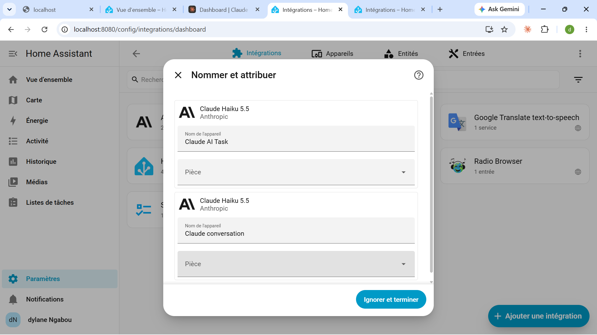
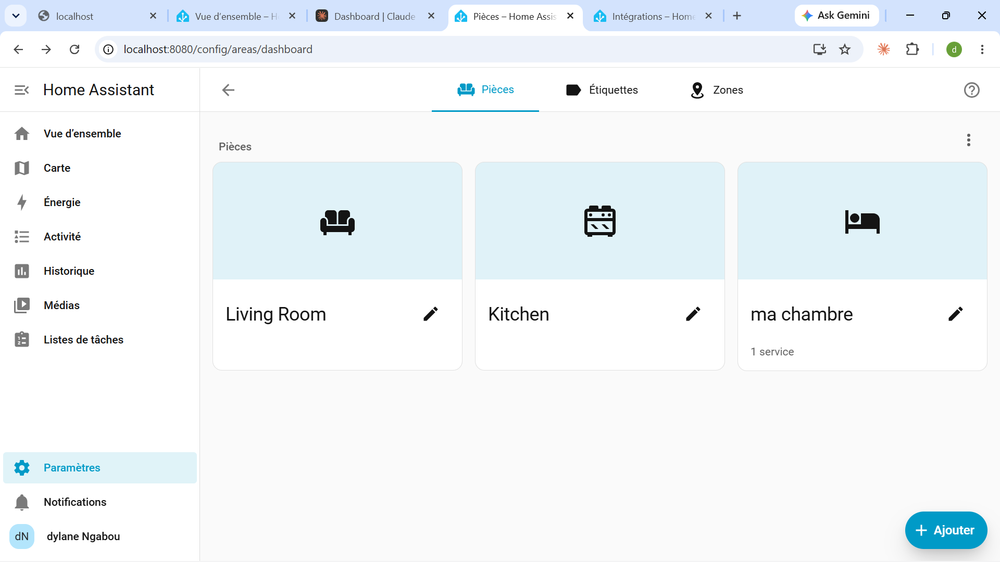
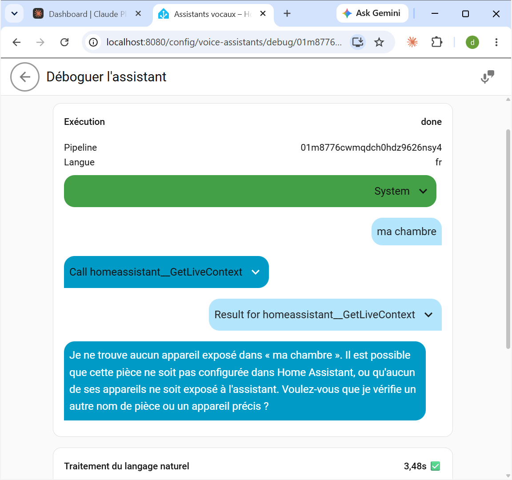
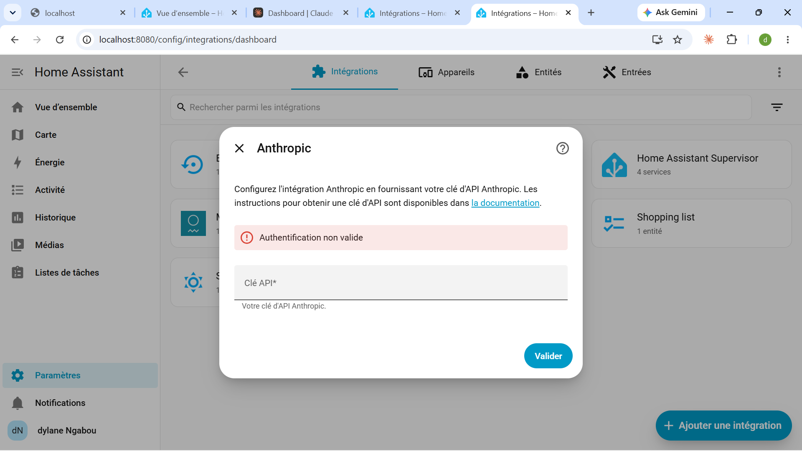

# Partie 2 — Brancher l'IA Claude

**Objectif :** donner un vrai « cerveau » conversationnel à Home Assistant avec **Claude** (Anthropic), capable de comprendre le français et d'agir sur la maison.

[← Partie 1](01-installation-vm.md) · [Partie 3 →](03-assistant-vocal.md)

---

## Étapes

### 1. Créer une clé API
Sur [console.anthropic.com](https://console.anthropic.com) : créer un compte, ajouter un peu de crédit, puis **API Keys → Create Key**.

> 🔒 La clé n'est **jamais** mise dans ce dépôt. Elle est collée directement dans Home Assistant.

### 2. Ajouter l'intégration Anthropic
Paramètres → Appareils et services → **Ajouter une intégration → Anthropic**, puis coller la clé.

Home Assistant crée **Claude conversation** (modèle Claude Haiku 5.5, rapide et peu cher) :

### 3. Créer ma chambre
La pièce « Bedroom » est renommée **« ma chambre »**, et Claude y est attribué.

### 4. Autoriser Claude à agir
Dans les options de Claude conversation : **Contrôler Home Assistant → Assist** coché.

### 5. Choisir Claude comme agent de l'assistant
Paramètres → Assistants vocaux → Home Assistant → **Agent de conversation : Claude conversation**.

### Résultat
Claude répond en français et consulte l'état de la maison (`GetLiveContext`) avant de répondre. Il n'y a pas encore d'appareil connecté, donc il le dit honnêtement :

---

## Problèmes rencontrés et solutions

### Problème 6 — « Authentification non valide » avec la clé API

- **Cause :** la clé n'avait pas été copiée en entier. La console Anthropic n'affiche une clé **qu'une seule fois**.
- **Solution :** créer une nouvelle clé et la copier avec le **bouton Copier** (pas à la souris). Vérifier qu'il y a du crédit dans Billing.

### Problème 7 — « Connexion perdue » dans Home Assistant
- **Cause :** Home Assistant redémarre ou se fige quelques secondes quand on installe un module ou une intégration. Mon PC n'avait aussi que ~2 Go de mémoire libre (trop d'onglets ouverts).
- **Solution :** attendre 30 secondes à 1 minute, puis recharger (F5). Fermer les onglets inutiles.
