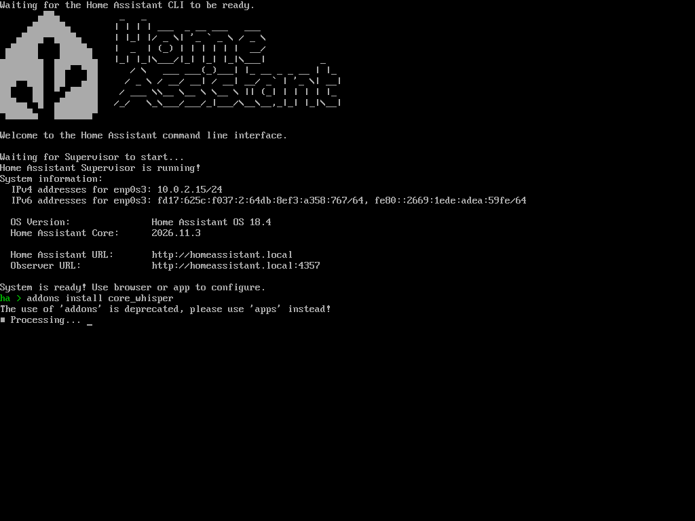
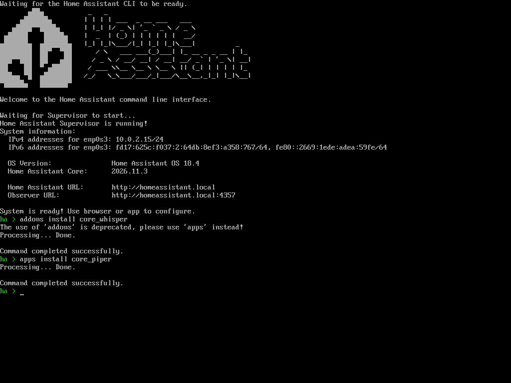
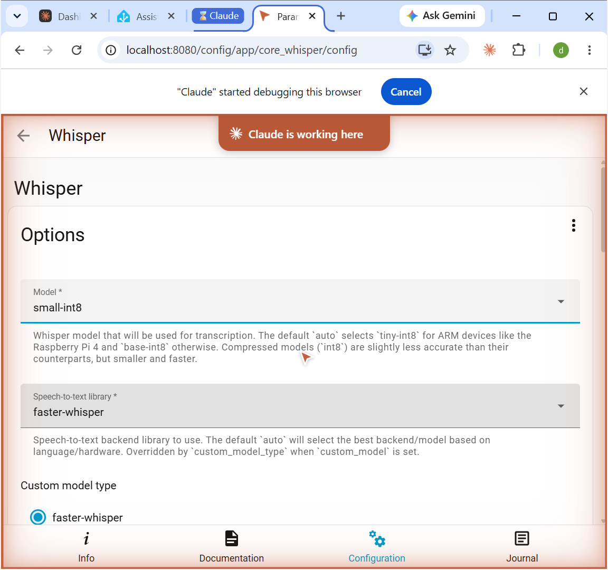
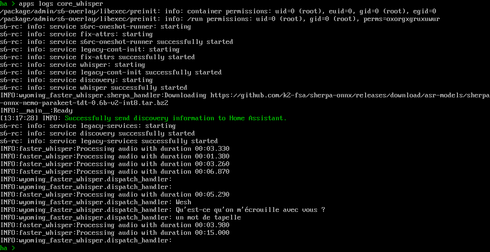
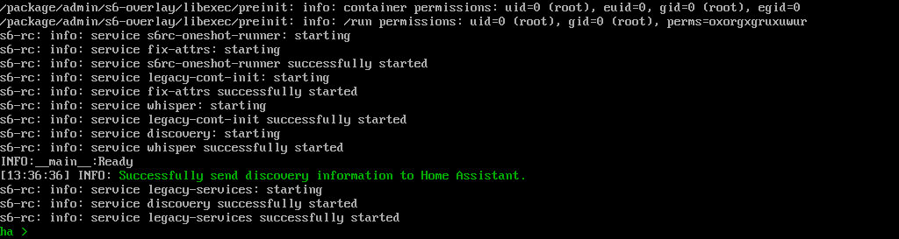
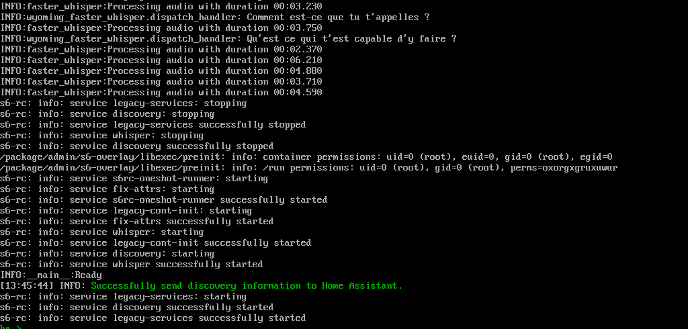

# Partie 3 — Assistant vocal : Whisper + Piper

**Objectif :** quand je parle, l'IA m'entend, exécute l'action, puis me répond **à voix haute**. Gratuitement et **en local**, sans service cloud pour la voix.

[← Partie 2](02-integration-claude.md) · [Partie 4 →](04-voix-elevenlabs-et-led-govee.md)

---

## La chaîne complète

```
🎙️ Micro du PC → 👂 Whisper (voix → texte) → 🧠 Claude (comprend + agit) → 🗣️ Piper (texte → voix) → 🔊 Haut-parleurs
```

## Étapes

### 1. Donner plus de puissance à la VM
La reconnaissance vocale demande beaucoup de calcul : la VM passe à **4 Go de RAM** et **4 processeurs**.

### 2. Installer Whisper (écoute) et Piper (parole)
Depuis la console Home Assistant :

```
ha apps install core_whisper
ha apps install core_piper
ha apps start core_piper
```





Home Assistant les détecte ensuite tout seul (« Appareils détectés »), il suffit de cliquer sur **Ajouter**.

### 3. Configurer Whisper en français
Paramètres → Applications → Whisper → Configuration :

| Option | Valeur |
|---|---|
| Speech-to-text library | **faster-whisper** |
| Model | **base-int8** |
| Language | **fr** |



### 4. Configurer l'assistant vocal
Paramètres → Assistants vocaux → Home Assistant :

| Réglage | Valeur |
|---|---|
| Langue | Français |
| Agent de conversation | Claude conversation |
| Reconnaissance vocale | faster-whisper (français) |
| Synthèse vocale | piper, voix fr_FR *siwis* |

### 5. Tester
Bulle 💬 en haut à droite → bouton micro 🎙️ → parler → l'IA répond à voix haute ✅

---

## Problèmes rencontrés et solutions

### Problème 8 — L'IA ne comprenait rien quand je parlais



- **Symptôme :** Whisper transcrivait n'importe quoi (« Wesh », « un mot de tapelle »…), et la page de débogage affichait parfois **« Timeout running pipeline »**.
- **Cause 1 :** en mode **auto**, Whisper avait choisi le modèle **Parakeet**, qui ne comprend **que l'anglais**.
- **Cause 2 :** la VM manquait de puissance (messages `rcu stall` dans la console).
- **Solution :** forcer **faster-whisper** en **fr**, et passer la VM à 4 processeurs.



### Problème 9 — Ça marchait une fois, puis plus rien, et c'était trop lent



- **Symptôme :** les 2 premières phrases étaient bien comprises (« Comment est-ce que tu t'appelles ? »), puis les suivantes n'étaient **jamais transcrites**.
- **Cause :** le modèle **small-int8** était trop lourd pour mon PC portable (i5 de 8e génération, déjà chargé à ~50 % avec ~2 Go de mémoire libre). Les demandes s'empilaient dans une file d'attente.
- **Solution :** passer au modèle **base-int8**, environ 3 fois plus rapide, puis redémarrer Whisper pour vider la file.
- **Leçon :** la reconnaissance vocale locale demande de la puissance. Un boîtier dédié (Home Assistant Green) ou Home Assistant Cloud répondra beaucoup plus vite.

### Problème 10 — Il répondait par écrit, mais ne parlait pas
- **Diagnostic, maillon par maillon :**
  1. Débogage → **Synthèse vocale ✅** : Piper créait bien le fichier audio.
  2. Le fichier se téléchargeait en 0,03 s : Home Assistant l'envoyait bien.
  3. Windows : sortie Realtek à 95 %, non coupée, et Chrome à 100 % dans le mélangeur de volume.
  4. Le fichier joué **directement par Windows** s'entendait.
  5. Conclusion : c'est **Chrome** qui bloquait le son du site.
- **Solution :** dans Chrome, icône ⓘ à gauche de l'adresse → **Paramètres du site → Son → Autoriser**, puis F5.
- **Leçon :** pour trouver une panne, tester **chaque maillon de la chaîne séparément**.

---

## Outil indispensable
**Paramètres → Assistants vocaux → ⋮ → Débogage** : montre ce que Whisper a entendu, la réponse de Claude, la synthèse vocale, et à quelle étape ça bloque.
