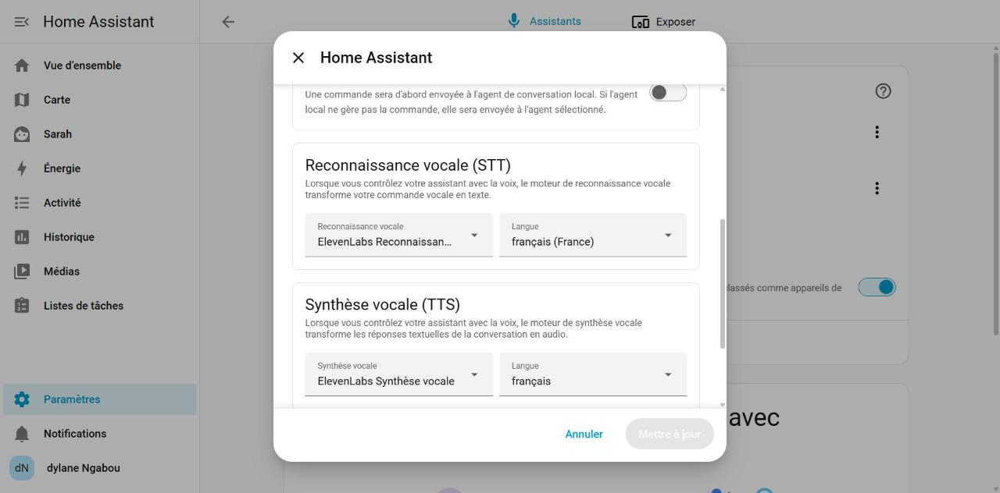
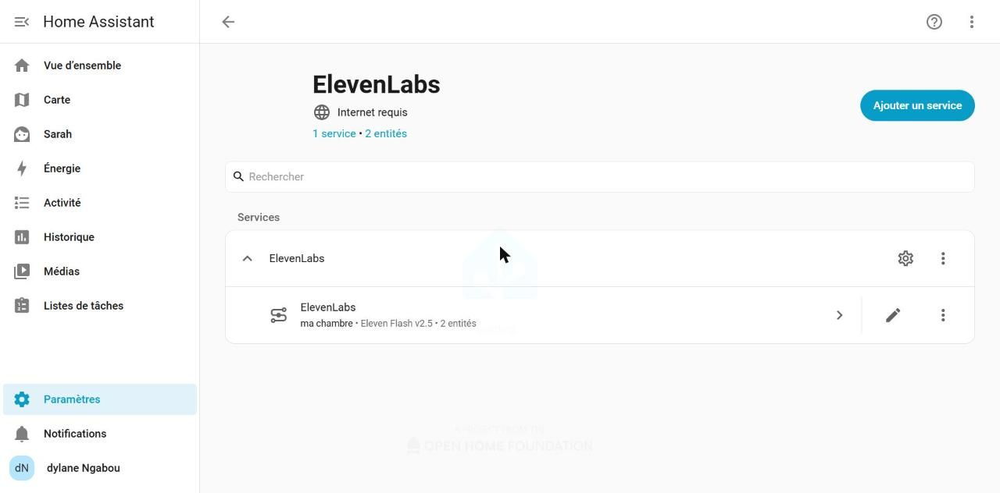
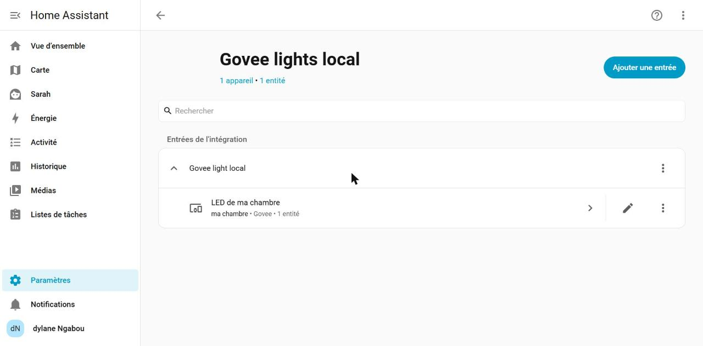

# Partie 4 — Voix réaliste (ElevenLabs) et vraies LED (Govee)

**Objectif :** remplacer la voix robotique par une voix humaine, puis brancher un **vrai appareil** : les LED Govee de ma chambre, que l'IA allume et change de couleur à la voix.

[← Partie 3](03-assistant-vocal.md) · [Partie 5 →](05-sarah-programme-bureau.md)

---

## Étapes

### 1. ElevenLabs : une voix naturelle
1. Créer un compte sur [elevenlabs.io](https://elevenlabs.io) (gratuit, ~10 000 caractères/mois), puis **Developers → API Keys → Create Key**.
2. Home Assistant → Paramètres → Appareils et services → **Ajouter une intégration → ElevenLabs** → coller la clé.
3. Dans l'assistant vocal, choisir **ElevenLabs** pour la synthèse vocale (voix **Sarah**) et pour la reconnaissance vocale (**français (France)**).
4. Dans les options de l'intégration, choisir le modèle **Eleven Flash v2.5**, le plus rapide.

> 🔒 La clé ElevenLabs n'est jamais mise dans ce dépôt.





### 2. LED Govee : contrôle local
1. Dans l'application **Govee Home** : LED → ⚙️ → activer **LAN Control**.
2. Mettre la VM en **mode pont** sur le Wi-Fi de la maison (le mode NAT ne voit pas les appareils du réseau).
3. Home Assistant → **Ajouter une intégration → Govee lights local** : la bande LED **H612D** est trouvée.
4. Renommer l'appareil **« LED de ma chambre »**, le ranger dans **ma chambre** et l'exposer à l'assistant.



### 3. Consignes données à Claude
```
Réponds toujours en français.
Pour changer la couleur d'une lumière, donne toujours le nom de la couleur en anglais (blue, red, green…).
Après chaque action exécutée, confirme en une phrase courte ce que tu as fait. Si une action échoue, dis-le.
Tu t'appelles Sarah. Réponds en une ou deux phrases courtes maximum, sans listes ni emojis.
```

### Résultat
« Mets les LED de ma chambre en bleu » → les LED passent au bleu, et Sarah répond « C'est fait, les LED de ta chambre sont en bleu. »

---

## Problèmes rencontrés et solutions

### Problème 11 — À la maison, la VM utilisait encore le DNS du collège
- **Cause :** la VM avait gardé les serveurs DNS du Wi-Fi du collège (inaccessibles depuis chez moi), donc Claude risquait de ne plus répondre.
- **Solution :** redémarrer la VM après chaque changement de réseau (collège ↔ maison). Elle prend alors le DNS de la box.

### Problème 12 — « La clé ElevenLabs est refusée »
- **Diagnostic :** le **journal des requêtes** d'ElevenLabs (Developers → Journal des requêtes) montrait que toutes les connexions de Home Assistant réussissaient (code 200).
- **Cause :** l'intégration avait bien été ajoutée, mais l'écran ne s'était pas mis à jour.
- **Leçon :** vérifier les journaux **des deux côtés** avant de recréer une clé.

### Problème 13 — Home Assistant ne trouvait pas les LED
- **Causes :** l'option **LAN Control** était désactivée dans l'application Govee, et la VM était en **NAT**, donc isolée du réseau de la maison.
- **Solution :** activer LAN Control et passer la VM en **mode pont**. Elle a alors obtenu sa propre adresse sur le réseau de la maison.

### Problème 14 — Le micro ne marche que sur « localhost »
- **Cause :** Chrome n'autorise le micro que sur une page **https** ou **localhost**. En mode pont, Home Assistant est sur une autre adresse.
- **Solution :** un petit relais Python, [`scripts/relais-localhost.py`](../scripts/relais-localhost.py), qui garde l'adresse `http://localhost:8080`.

### Problème 15 — « Allume en bleu » : allumé, mais pas en bleu
- **Cause :** le journal affichait `Unknown color`. Claude envoyait « bleu », et Home Assistant ne comprend que les noms de couleur **anglais**.
- **Solution :** une consigne dans les instructions de Claude (voir plus haut).

### Problème 16 — Claude disait avoir échoué alors que ça avait marché
- **Cause :** les LED renvoient leur nouvel état avec **5 à 10 secondes de retard**, et Claude vérifiait trop tôt.
- **Solution :** savoir que c'est normal pour ce modèle de LED. Les commandes, elles, marchent tout de suite.

### Problème 17 — Elle répondait, mais on n'entendait rien
- **Diagnostic, maillon par maillon :** les fichiers audio étaient bien créés, et la lecture démarrait dans Chrome.
- **Cause :** la sortie audio de Windows était la carte **Scarlett Solo** (reliée aux enceintes), mais elle était **en muet**.
- **Solution :** réactiver le son de la Scarlett dans Windows.
