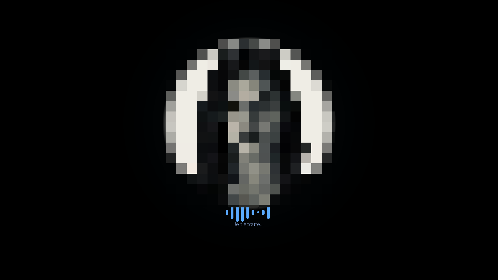
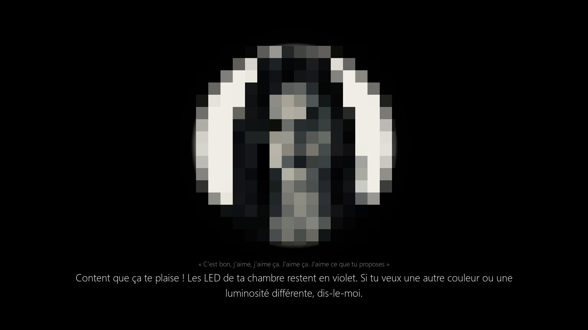
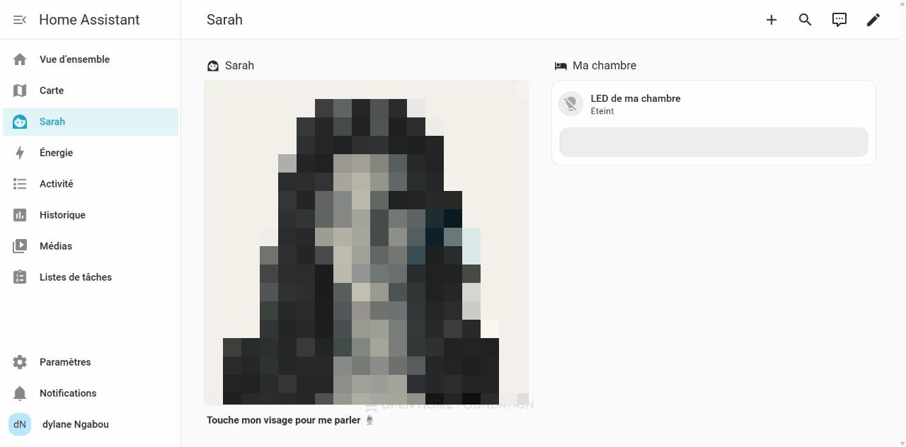

# Partie 5 — Sarah : une IA toujours active, avec un visage

**Objectif :** comme dans la vidéo qui m'a inspiré, je dis **« Hey Sarah »** sans rien toucher, et son **visage apparaît en plein écran**. Il **réagit à ma voix**, puis elle exécute l'action, **répond à voix haute** et disparaît.

[← Partie 4](04-voix-elevenlabs-et-led-govee.md) · [Retour au README](../README.md)

---

## Fonctionnement

```
🎙️ Micro du PC ──► Vosk (hors ligne) détecte « Sarah »
                      │
                      ▼
              Visage plein écran (lueur bleue + barres qui suivent ma voix)
                      │  fin de phrase détectée (0,8 s de silence)
                      ▼
   Home Assistant : ElevenLabs Scribe (voix → texte) → Claude (agit sur les LED) → ElevenLabs (texte → voix)
                      │
                      ▼
              Lueur violette (réflexion) → lueur blanche animée par sa voix + sous-titres → disparaît
```

Le code est dans [`sarah-desktop/`](../sarah-desktop/) : un seul fichier, [`sarah.py`](../sarah-desktop/sarah.py).

| Brique | Rôle |
|---|---|
| **Vosk** + modèle français (41 Mo) | Écoute en permanence, **hors ligne**, et ne réagit qu'au mot « Sarah » |
| **sounddevice** | Lit le micro du PC |
| **websockets** | Envoie la voix au pipeline Assist de Home Assistant, en direct |
| **pygame** | Fenêtre plein écran, animations et lecture de la voix |

## Les écrans

| Elle m'écoute | Elle répond |
|---|---|
|  |  |

> Le visage est pixelisé sur GitHub : c'est la photo d'une vraie personne.

J'ai aussi créé un tableau de bord **« Sarah »** dans Home Assistant : quand je touche son visage, elle commence à m'écouter.



## Installation
Voir [`sarah-desktop/README.md`](../sarah-desktop/README.md).

## Contrôle du volume du PC à la voix
« Sarah, mets le volume à 25 % », « Sarah, monte un peu le son », « Sarah, coupe le son »…

```
Claude ──► script Home Assistant « Volume du PC » (action + valeur)
              │  événement « sarah_pc_volume »
              ▼
sarah.py (abonné aux événements) ──► volume.ps1 ──► volume de Windows
```

- Dans Home Assistant, le script **Volume du PC** a deux champs : `action` (niveau, monter, baisser, muet, son) et `valeur` (0 à 100 %). Il est exposé à l'assistant, donc Claude sait l'utiliser tout seul.
- Le script ne fait qu'envoyer un **événement**. C'est `sarah.py`, sur le PC, qui le reçoit et appelle [`volume.ps1`](../sarah-desktop/volume.ps1).
- **Sécurité :** seules ces 5 actions sont acceptées, et la valeur est bornée entre 0 et 100. Sarah ne peut rien faire d'autre sur le PC.

| Phrase | Réponse de Sarah | Volume réel de Windows |
|---|---|---|
| « Mets le volume du PC à 25 % » | « C'est fait, le volume du PC est réglé à 25 %. » (1,4 s) | 25 % |
| « Monte un peu le son » | « C'est fait, j'ai monté le son du PC de 10 points. » (2,0 s) | 35 % |
| « Remets le volume à 40 % » | « C'est fait, le volume du PC de la chambre est réglé à 40 %. » (1,1 s) | 40 % |

## Musique avec Spotify
« Sarah, mets Drake », « Sarah, mets Meuda de Tiakola », « Sarah, mets une playlist rap », « Sarah, suivant », « Sarah, pause ».

```
Claude ──► script « Jouer de la musique » (recherche + type : titre, artiste, album, playlist)
              │  événement « sarah_musique »
              ▼
sarah.py ──► API Web Spotify : recherche (spotify_recherche.py) ──► lien spotify:track:… / spotify:artist:…
         ──► Home Assistant (intégration Spotify) : appareil « JORIS » (le PC) + lecture
```

- **Intégration Spotify** de Home Assistant, avec une app développeur Spotify (Client ID et secret) et un compte **Premium**, obligatoire pour piloter la lecture.
- La recherche par nom se fait dans [`spotify_recherche.py`](../sarah-desktop/spotify_recherche.py), avec les identifiants de l'app gardés dans `spotify.txt` (jamais sur GitHub).
- Pause, reprise, suivant, précédent et volume de la musique : Claude utilise directement le lecteur « Musique » (Spotify) exposé à l'assistant.
- **La musique baisse à 20 %** dès que je dis « Sarah » et remonte quand elle a fini de parler. Seul le son de Spotify change, pas celui de Sarah, grâce à [`musique.ps1`](../sarah-desktop/musique.ps1).

| Phrase | Réponse | Ce qui joue vraiment (vérifié dans Windows) |
|---|---|---|
| « Mets Drake » | « Je lance Drake sur les enceintes de ta chambre. » (2,0 s) | One Dance – Drake |
| « Passe au morceau suivant » | « Je passe au morceau suivant. » (1,6 s) | Janice STFU – Drake |
| « Mets la musique en pause » | « La musique est en pause. » (1,7 s) | En pause |

## Démarrage automatique
À l'ouverture de ma session Windows, [`scripts/demarrer-sarah.ps1`](../scripts/demarrer-sarah.ps1) démarre la VM Home Assistant sans fenêtre, le relais `localhost:8080`, puis Sarah. Je n'ai plus rien à lancer : il suffit de dire « Sarah ».

---

## Problèmes rencontrés et solutions

### Problème 18 — Je parlais, mais elle ne se réveillait pas
- **Diagnostic :** j'ai mesuré les 3 micros du PC pendant que je parlais.

| Micro | Niveau maximum |
|---|---|
| Scarlett Solo | 1 / 32767 (rien) |
| **Micro intégré du portable** | **32767 / 32767** |
| Iriun Webcam | 1 / 32767 (rien) |

- **Cause :** le programme écoutait le micro par défaut de Windows, la Scarlett, où aucun micro n'est branché.
- **Solution :** choisir le micro dans `config.ini` (`micro = Intel MME`).

### Problème 19 — Elle était beaucoup trop lente (30 à 50 secondes)
- **Causes :**
  1. Home Assistant n'arrivait pas à détecter la fin de ma phrase à cause du bruit de fond : il écoutait jusqu'à 30 secondes.
  2. Whisper, en local sur mon PC portable, mettait 6 à 7 secondes à transcrire, et se trompait souvent (« Allume les lettres enviolés »).
  3. Les réponses longues prenaient jusqu'à 6 secondes à être lues par la voix.
- **Solutions :**
  1. Le programme détecte **lui-même** la fin de la phrase : il mesure le bruit de fond en continu et s'arrête après 0,8 s de silence.
  2. Reconnaissance vocale par **ElevenLabs Scribe** : 0,3 à 0,9 s, et beaucoup plus précise.
  3. Modèle de voix **Eleven Flash v2.5** et consigne « réponds en une ou deux phrases ».
- **Résultat mesuré :** de la fin de ma phrase à sa réponse, **1,9 seconde**, contre 30 à 50 secondes au départ.

### Problème 20 — « Aucune interaction quand je parle »
- **Solution :** le visage réagit en direct.
  - Pendant l'écoute, la lueur et des **barres bleues** suivent le volume de **ma** voix.
  - Pendant la réponse, je calcule le volume de **sa** voix 30 fois par seconde : la lueur et le visage bougent au rythme de ses syllabes.

### Problème 21 — Elle se réveillait toute seule et oubliait la conversation
- **Causes :** elle entendait sa propre voix dans les enceintes, et chaque demande démarrait une nouvelle conversation (« Oui » ne voulait plus rien dire pour elle).
- **Solutions :** elle ignore le micro pendant 2 secondes après avoir parlé, et le programme renvoie le `conversation_id` pendant 5 minutes pour garder le fil.

### Problème 22 — Elle se réveillait alors que je ne l'avais pas appelée
- **Symptôme :** elle réagissait à des phrases sans son nom (« Ouais, tu dis quoi ? », « C'est bon, tu peux partir »…).
- **Cause :** pour détecter le mot de réveil, j'avais limité Vosk à un vocabulaire d'un seul mot : « sarah ». Il essayait alors de faire correspondre **n'importe quelle phrase** à ce mot.
- **Test :** 66 phrases générées avec 3 voix différentes, avec et sans « Sarah » :

| Méthode | Faux réveils (phrases sans « Sarah ») | Bons réveils (phrases avec « Sarah ») |
|---|---|---|
| Vocabulaire d'un seul mot | 38 / 48 | 17 / 18 |
| **Vocabulaire français complet** | **0 / 48** | 12 / 18 (12 / 12 avec les 2 voix les plus claires) |

- **Solution :** Vosk reconnaît toute la langue française, et Sarah ne se réveille que si le mot « sarah » (ou « sara ») est vraiment entendu.
- **Vie privée :** tant qu'elle n'est pas appelée, l'écoute se fait **uniquement sur le PC**, hors ligne. Rien n'est enregistré ni envoyé sur Internet. Ma voix n'est envoyée à Home Assistant et à ElevenLabs **qu'après** « Sarah ».

### Problème 23 — Le tableau de bord « sarah » refusait d'être créé
- **Cause :** l'adresse d'un tableau de bord Home Assistant doit contenir un **tiret**.
- **Solution :** `ia-sarah`.

### Problème 24 — Avec des réponses plus longues, elle mettait 16 à 20 secondes à parler
- **Mesures :** Claude répondait en 2 à 4 s, mais la **fabrication de la voix** prenait 16 à 20 s.
- **Cause 1, le relais :** sous Windows, `localhost` est d'abord essayé en **IPv6** (`::1`), alors que le relais n'écoutait qu'en IPv4 (`127.0.0.1`). Chaque requête attendait **2 secondes** avant le repli : 0,02 s en direct, 2,0 s par le relais.
- **Cause 2 :** la voix de toute la réponse était fabriquée d'un bloc avant que Sarah commence à parler.
- **Cause 3 :** ElevenLabs, appelé à travers Home Assistant, est irrégulier (2,6 à 9,5 s pour une phrase courte certains soirs).
- **Solutions :**
  1. Le relais écoute en IPv4 **et** en IPv6, et Sarah utilise `127.0.0.1`.
  2. La réponse est découpée en morceaux d'une ou deux phrases, fabriqués **en parallèle** et joués dans l'ordre : Sarah commence dès que la première phrase est prête.
  3. Des réponses de conversation plus courtes (deux ou trois phrases).
- **Piste écartée pour l'instant :** appeler ElevenLabs directement en streaming depuis le PC (plus rapide, mais il faut garder une clé ElevenLabs sur le PC).

### Problème 25 — Apple Music pour Windows ne se laisse pas piloter
- **Essai :** l'application **ignore les liens** `music://` vers un titre (elle s'ouvre sans aller sur le morceau). Piloter son interface (recherche, album, menu « … » → « Play ») a marché deux fois, puis échoué selon les recherches.
- **Solution :** passer à **Spotify**, qui a une vraie API et une intégration officielle Home Assistant. Apple Music reste pilotable pour lecture, pause et suivant par les contrôles multimédias de Windows (`musique.ps1`).

### Problème 26 — Impossible de créer l'app développeur Spotify
- **Cause :** Spotify exige une **adresse e-mail vérifiée**, et l'e-mail de vérification n'arrivait pas (adresse iCloud).
- **Solution :** vérifier les courriers indésirables, renvoyer l'e-mail, ou changer l'adresse du compte.
- **Piste étudiée :** Spotify Soloist (lecteur sans interface avec une simple clé API) joue sur le PC, mais **ne sait pas chercher** un titre par son nom.

### Problème 27 — « Ça refuse de se connecter » à Spotify
- **Cause :** après l'autorisation, Spotify renvoie vers **my.home-assistant.io**, qui redirigeait vers l'adresse par défaut `homeassistant.local:8123`. Mon Home Assistant répond sur `localhost:8080`.
- **Solution :** sur my.home-assistant.io, régler l'adresse de l'instance sur `http://localhost:8080` (réglage gardé dans le navigateur), puis relancer l'ajout de Spotify.

### Problème 28 — « Je lance Drake »… mais rien ne jouait
- **Diagnostic :** Home Assistant ne met à jour l'état de Spotify que toutes les 30 secondes. J'ai donc vérifié **ce qui joue vraiment** avec les contrôles multimédias de Windows : Spotify était resté en pause.
- **Cause :** j'envoyais l'**artiste** comme si c'était un **titre** (`media_content_type: music`), et Spotify l'ignorait sans erreur.
- **Solution :** titre → `music` ; artiste → `artist` ; album → `album` ; playlist → `playlist`.
- **Autre détail :** juste après avoir choisi l'appareil « JORIS », Home Assistant ne propose pas encore la lecture. Le programme actualise le lecteur jusqu'à ce que la lecture soit possible (environ 1 à 2 s).

### Problème 29 — Après la musique, elle ne répondait plus
- **Cause 1 :** **deux Sarah** tournaient en même temps (lancées à 8 secondes d'écart). Elles se disputaient le micro et lançaient la musique deux fois.
- **Solution :** au démarrage, Sarah réserve un port local (127.0.0.1:47853). Une deuxième copie voit qu'il est pris et s'arrête toute seule (« Sarah tourne déjà »).
- **Cause 2 :** la musique qui sort des enceintes **couvre ma voix** pour le micro du portable.

### Problème 30 — L'entendre pendant la musique (en cours)
- **Mesures** (je dis « Sarah » 5 fois pendant la musique) :

| Essai | « Sarah » entendus |
|---|---|
| Micro du portable, 1er morceau | 3 / 5 |
| Micro de la webcam C920, 1er morceau | 3 / 5 |
| Micro du portable, morceau plus fort | 0 / 5 |

- **Solution de secours :** le raccourci **Ctrl + Espace** réveille Sarah à coup sûr. La musique baisse aussitôt et elle écoute (réglable dans `config.ini`, ligne `raccourci`).
- **Annulation d'écho logicielle essayée :** le son envoyé aux enceintes peut être lu (bibliothèque PyAudioWPatch, en « loopback »), mais il ne ressemble qu'à **3 %** à ce que capte le micro du portable. Le micro Intel traite déjà le son (réduction de bruit), donc un filtre linéaire n'enlève rien (0 dB).
- **Pistes pour la suite :** refaire l'essai avec le micro de la C920 (son plus brut), plafonner le volume de la musique, ou un micro avec **annulation d'écho matérielle** (Home Assistant Voice, haut-parleur de conférence USB).

---

## Ce que j'ai appris
- Mesurer avant de corriger : niveaux des micros, temps de chaque étape, journaux.
- Le **streaming audio** par WebSocket vers le pipeline Assist de Home Assistant.
- La détection d'un **mot de réveil** hors ligne, sans entraîner de modèle, grâce à une grammaire Vosk limitée.
- Le compromis entre le **local** (gratuit et privé, mais lent sur un PC portable) et le **cloud** (rapide et précis, mais payant au-delà du forfait gratuit).
